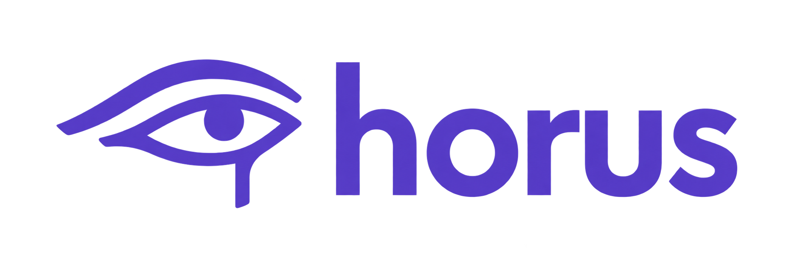

# horus



[简体中文](README.zh-CN.md) · [Setup](docs/usage.md) · [Architecture](docs/architecture.md)

horus is an AI-native API testing platform for coding agents, connected through
MCP and a portable Skill. It brings business understanding, API call dependencies,
functional checks, and basic load tests into the conversation where you develop your service.

Provide an OpenAPI/Swagger definition and the business behavior you want to verify.
The agent proposes a test plan for you to review. After you confirm it, horus runs
the tests with Hurl and k6, cleans up test data, and returns the report.

```text
OpenAPI / Swagger → Agent plan → Human confirmation → Hurl + k6 → Report
```

## Features

- **Business logic and call chains.** The agent connects requirements and API
  contracts to requests and checks, with optional source context. Plans record
  their evidence, assumptions, and gaps.
- **Functional testing.** Verify response data, ownership rules, state changes,
  conditional paths, and asynchronous workflows, including data preparation and cleanup.
- **Load testing.** Set concurrency, iterations, and limits before execution.
  Check latency, HTTP errors, data errors, and completed iterations. Resource
  observations over SSH are optional and require authorization.
- **Repeatable execution.** Runs keep separate state and results. Reviewed plans
  can be exported and replayed through the CLI without MCP or a model. Interrupted
  runs support a separate cleanup attempt; uncertain outcomes remain visible.

horus runs locally and uses the host agent's existing model and tools. The current
alpha runs on macOS and Linux and tests HTTP/REST APIs with JSON, regardless of
the backend's programming language. See [current limits](docs/architecture.md#current-limits).

## Quick start

Copy this into your coding agent:

```text
Follow https://github.com/xucailiang/horus/blob/master/docs/usage.md to install
horus, configure its MCP server and Skill in this coding tool, and verify the connection.
```

The agent handles dependencies, MCP configuration, and Skill installation using
the [setup guide](docs/usage.md). Manual steps are in the same guide.

Any coding tool with local MCP support can use horus. Load the Skill through the
client's Skill mechanism, or have the agent read `skills/horus/SKILL.md`. Codex and
Claude Code have been verified; other clients use the same server and workflow.

Once installed, start a test:

```text
Use horus to test <service URL>, with the API definition at <OpenAPI/Swagger URL>.
Understand the business rules and call dependencies, then propose functional
and basic concurrency tests, including data preparation and cleanup.
Show me the plan and load limits first. After I confirm, run it and return the report.
```

The agent shows the plan directly in the conversation before saving or executing
it. Confirmation applies to that version and scope; changes require another review.

## Reports

Each run has one directory containing its plan and results. Markdown documents
follow the conversation language:

| File | Contents |
| --- | --- |
| `plan.md` | Confirmed plan, business rules, and full Mermaid call graph |
| `report.md` | Verdict, problems, business results, key metrics, and a compact business diagram |
| `details.md` | Step checks and execution evidence |

The directory also includes the executable plan, full redacted results in JSON,
and a JUnit report. Unrun paths and unresolved cleanup are reported explicitly.

## Documentation

- [Setup, configuration, and CLI usage](docs/usage.md)
- [Testing and verification](docs/testing.md)
- [Architecture and limits](docs/architecture.md)
- [Requirements](docs/PRD-horus.md) and [technical design](docs/TECHNICAL-DESIGN.md) (Chinese)

## Contributing

Bug reports and pull requests are welcome. See [CONTRIBUTING.md](CONTRIBUTING.md)
for environment setup and local checks. Keep the English and Chinese READMEs in sync.

## License

[MIT](LICENSE)
