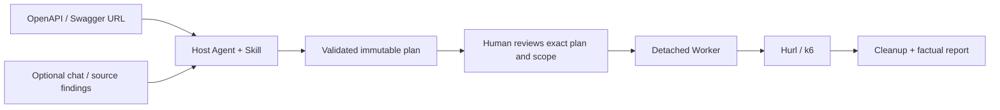

# Architecture

horus has a small deterministic core. The host Agent supplies language-model
reasoning and uses its existing tools to inspect optional source code. horus
does not run a model, clone business repositories, or build a source index.

## Boundaries

| Component | Responsibility |
| --- | --- |
| `core/models.py` | Strict shared plan, policy, and resource-observation contracts |
| `core/service.py` | Projects, API imports, validation, review materials, and approval gate |
| `core/validation.py`, `core/steps.py` | Path scopes, output guarantees, operation policy and worst-path budgets |
| `core/store.py` | Content hashes, atomic writes, file locking, project-scoped references |
| `core/runs.py` | Idempotent starts, persistent state, cancellation, cleanup recovery, report attachments |
| `core/runner.py` | Variable resolution, execution, captures, assertions, cleanup, reports |
| `core/values.py` | Case data, identity scopes, credential aliases, dynamic values, redaction |
| `adapters/` | OpenAPI discovery and bounded Hurl/k6 subprocess adapters |
| `worker.py` | Detached run ownership, heartbeat, project execution lease |
| `mcp/server.py`, `cli.py` | Transport and command interfaces to the same core |
| `skills/horus/` | Host workflow, human confirmation, optional SSH monitoring guidance |

The target backend's language is irrelevant to execution. Plans address HTTP
operations from an imported API definition; business concepts live in the plan.

## Plans and review

A plan contains business understanding, evidence, coverage mappings, cases,
requests, captures, assertions, cleanup, and optional load/resource settings.
Dynamic values use `${vars.name}`, `${secrets.binding}`, and `${run.id}`.
A full placeholder preserves its JSON type; `$${...}` represents a literal.

Identity profiles map credential aliases to configured binding names. Each HTTP,
load, and cleanup step selects its identity explicitly. Case contexts combine
shared business data with only that identity's authentication captures and aliases.
An omitted identity uses a separate default scope. `purpose=authentication` controls
credential isolation and redaction; `secret=true` on other data controls redaction
and persistence without changing its case scope. Validation checks variable sources
within these same scopes before review, including assertions and cleanup inputs.

Sources, configs, plans, review bundles, and decisions are immutable and addressed
by SHA-256 over canonical JSON. References are checked within the current project.
Approval binds the exact plan, config, project identity, target URL, and execution
policy. A changed plan or scope requires another human review.

The Skill asks the user to reply **“我确定”** after displaying the concrete plan.
An instruction that quotes this phrase is not approval. The trusted host records
the actual decision separately from the plan. This is a local audit record;
content hashes do not independently authenticate a human reviewer.

## Execution and recovery

`start_run` registers a request ID and parameter digest before spawning a Worker.
The same request returns the same run; conflicting parameters are rejected.
One active run holds a project lease; separate projects may run concurrently.
Consecutive functional cases use a shared queue with the reviewed limit of one or
two consumers. Each case has its own context and retains its slot through cleanup;
an ordinary check failure does not stop an independent case. Reports keep plan order,
case start/finish times, and observed peak concurrency. A performance case waits
for the previous group, runs exclusively through cleanup, then releases the next
group. Load uses fixed k6 VUs and iterations.
Polling repeats only explicitly declared read operations within fixed attempt and
time limits. Typed predicates inspect prior variables and the current response;
status guards apply to every attempt, final assertions and captures to completion.
Intermediate conditions are recorded as observations rather than passing checks.
Branches select among frozen paths using prior variables. Declared outputs must
exist on every path; conditional data requires an existence guard. Authentication
keeps its identity scope across those paths. Reports distinguish unselected steps
from passes, and recovery follows the persisted selection rather than rerouting.

Closing an MCP connection does not stop a Worker. Ordinary cancellation stops new
business actions and terminates active load and polls. In-flight bounded HTTP
requests in sibling cases can finish so successful writes can be captured before
independent bounded cleanup. Cases that never started send no cleanup requests.

Each engine has a small guardian. A pipe links it to the Worker; Worker death
closes the pipe and stops the engine. The guardian retains the project lease until
the engine has exited, preventing overlap with a new run after a crash.

The ledger records intent before a request and captured nonsecret identifiers
after responses. Interrupted writes are never replayed automatically. A missing
Worker eventually yields an interrupted report with unknown outcomes.

An explicit `cleanup_run` starts a separate bounded attempt under the original
approval and project lease. It restores nonsecret ledger values, preserves the
original `run.id`, and runs approved cleanup. Required authentication steps and
their authentication predecessors may run only within `cleanupAllow`; preparation
and exercise steps are never replayed. Captured credentials remain available to
cleanup even when another authentication assertion fails.
Authentication predecessors are selected by both identity and variable name, so
repairing one account cannot satisfy another account's credential dependencies.

Recovery does not reconstruct secret IDs or lost sessions. Unknown original writes,
unrecoverable credentials, and unverified cleanup remain in the recovery report.
Missing cleanup inputs cannot produce a pass. The original report stays intact.

## Reports and optional resource observations

Runs produce `summary.json`, `report.json`, `report.md`, and `junit.xml`, plus an
MCP-readable report artifact. Runtime payloads are redacted before persistence.
Control fields and verdicts are kept separate from payload redaction.

Regex assertions use ECMAScript Unicode semantics. Functional checks use the
[`regress` binding](https://github.com/crate-py/regress); load checks use k6's
`RegExp` with the `u` flag. A functional response's regex matches run together in
a private child process with a one-second limit. The same guardian and project
lease used for HTTP/load processes stop it after timeout, cancellation, or Worker
death. Raw matching inputs are removed with the private temporary directory.
Load plans reject Unicode property escapes before review because the pinned k6
runtime does not implement those matches correctly. Functional checks support them.

k6 reports configured/observed VUs, completed iterations, request count,
throughput, average/P50/P95/P99/max latency, HTTP error rate, and per-response
data-check failure rate. Missing samples, incomplete execution, or absent
thresholds cannot produce an unconditional performance pass.

Resource monitoring is optional. With explicit user authorization, a host Agent
or subagent may maintain one bounded SSH session for CPU/GPU/memory observations.
A short baseline informs proposed concurrency; approved load is never changed
silently. Runtime samples can be attached to the report without changing the HTTP
verdict. horus does not implement an SSH service or remote monitoring agent.

## Current limits

HTTP/load/poll/branch steps, identity profiles, and bounded functional case
parallelism are implemented. Common Swagger UI discovery
patterns are supported; arbitrary dynamic pages and external schema references
may require a direct, self-contained API definition.

The detailed Chinese design and historical decisions remain available in
[the technical design](TECHNICAL-DESIGN.md) and [ADRs](decisions/).
